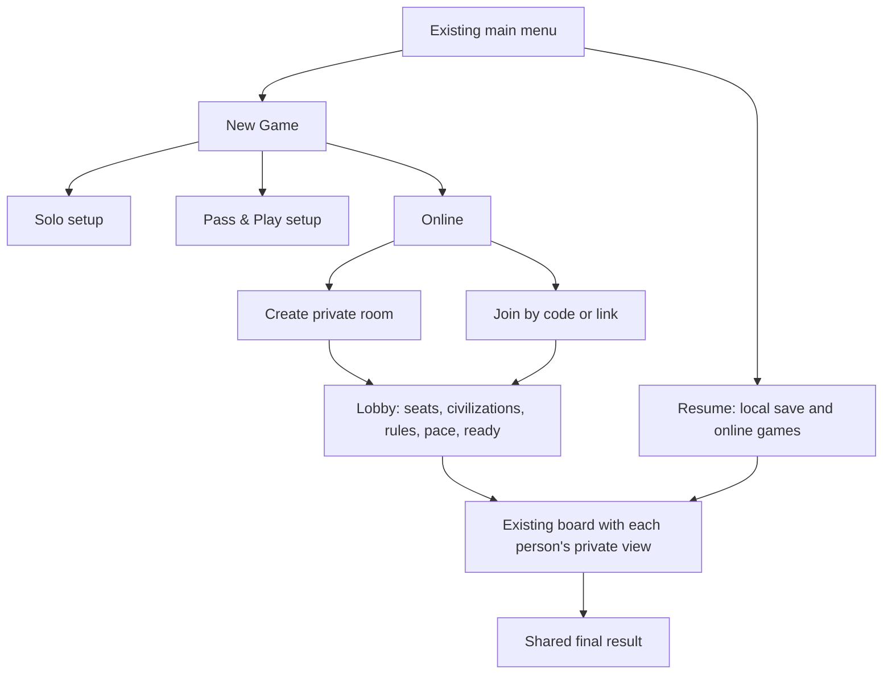

# Online multiplayer — deferred product and architecture proposal

## Confirmed direction

Alex requested this planning work on November 6, 2026, after authorizing the
merge of the reviewed ratings feature. PR 71 merged as `2943bab`; its tree is
identical to reviewed head `5d4646f`. Hosted Engine + AI builds/tests and
SwiftLint passed. The compact-phone run and full current-head Mac gate remain
unrun because of disk capacity; merging did not turn those into passes.

Alex subsequently prioritized **pass-and-play on one device before online
multiplayer**. Local human play will be designed first using the repository's
grill-me workflow. This online proposal remains deferred until that foundation
is settled; its suggested local UI and handoff details are not locked decisions.

For the later online feature, Alex explicitly selected **both live sessions
and asynchronous play**, using **existing three/four-seat tables with optional
AI seats**. A distinct two-player ruleset is outside this plan. This document
proposes the online feature and its stages; it does not authorize silently
changing game rules or deploy a backend.

The experience should remain Empires: the existing board, painted navy/gold
controls, civilizations and clear action dock. The motivation is to let Alex,
Jake and Kyle start, leave, resume and finish a game together without sharing a
phone or losing progress when somebody disconnects.

## Proposed product contract

- New Game offers **Solo**, **Pass & Play**, and **Online** as play types.
  These are distinct from board mode, rules and AI difficulty.
- Online supports private friend rooms, invitations by link/code and a list of
  active games. Each person owns a seat through an authenticated identity;
  display names remain labels.
- Live and asynchronous rooms use the same rules and durable match system.
  Their pace changes response windows, notifications and leaving behavior.
  Live play updates foreground phones promptly; asynchronous play preserves
  pending decisions until the relevant person returns or the agreed room
  policy resolves a deadline.
- Reuse supported three/four-seat tables, allowing two or more human players
  with optional AI seats. Alex selected this approach; a true two-seat duel is
  outside scope.
- The complete release covers the supported Classic, Conquest, Vast, Vast
  Conquest and Voyages configurations, including fog, ships, resource choices,
  cards and ordinary trading. The lobby locks a shared rules/version contract.
- A phone always shows its own person's private hand. Other phones receive
  public information and their own private information only.
- Closing the app, losing a response, or switching networks must preserve the
  last accepted move. Retrying must not roll twice, buy twice or collect twice.
- Returning to the menu, starting Solo or opening another room preserves other
  online games. They are independent of the single local save/replacement flow.
  Leaving a lobby, leaving the board view and resigning a started match are
  distinct actions; resignation requires explicit confirmation and agreed rules.
- Existing solo saves and AI ratings remain intact. Online and local human
  matches need their own result/rating policy; they do not enter AI Elo pools.

Private friend rooms are the proposed scope. Public matchmaking, chat and
spectating are separate decisions; they are not prerequisites for two phones
to play a complete game together.

## What exists, and what needs changing

| Existing code | Reuse | Required change |
| --- | --- | --- |
| `CatanEngine` and `GameSession` | Rules, seeded replay, legal application, checkpoints and AI-driving state | A remote authority and participant-aware command contract |
| Candidate session → durable checkpoint → presentation | Keep commit-before-publish ordering | Commit on the authority before acknowledging phones |
| `PlayerRoster` and civilizations | Seat identity, appearance and roster concepts | Separate authenticated viewer, seat controller and owed actor |
| CloudKit ladder sync | Existing names, identities and completed-history context | It is not a lobby or live command transport |
| Existing saved multi-human games | Preserve compatibility | Restore new pass-and-play creation and add a privacy handoff |
| Board and action surfaces | Preserve camera/reserve invariants and theme | Project online state and show connection/pending-action status |

Current `MatchSetup.newGameProblem` requires exactly one human and normalizes
new-game preferences accordingly. Legacy multi-human saves still resume.
`GameViewModel.humanPlayer` follows whoever owes an action for those saves,
without a handoff cover. Therefore pass-and-play is a deliberate restoration
and privacy task, not a feature we can assume is already finished.

## Player journey and UI

Keep the main menu composition. Put creation/joining inside New Game, and use
the existing resume area to reach active games. When multiple games exist,
Resume opens a compact list showing whose action is needed; one solo save can
retain its direct-resume behavior. Completed online games belong in history.

The lobby shows actual participants, vacant/AI seats, civilization choices,
connection/readiness, complete rules and the selected pace. Reserve seats and
civilizations atomically. Everyone sees the configuration before becoming
ready; a host cannot silently change the pace or rules after the game starts.
Ready confirmations belong to an exact configuration revision. Changing rules,
pace, roster or AI configuration before Start clears readiness; Start atomically
checks that every required participant accepted the current configuration.
Lobby-host departure and invitation expiry need explicit room lifecycle rules.

During a game, distinguish **turn owner** from **person who must respond**.
Use language such as “Jake's turn,” “Alex is discarding,” and “Choose two
resources.” Show “Sending…” only for an action awaiting acceptance and
“Reconnecting…” when the phone is catching up. Camera, zoom and unsubmitted
choices stay local. Add status within the existing reserved chrome so it
cannot resize or recenter the board.

Pass-and-play uses a cover between people: “Pass to Kyle” followed by an
explicit reveal. Handoffs also cover off-turn discards, private cards and
resource choices. Online never swaps the phone's viewer to another person.

## One durable authority for both paces

The provisional recommendation is a persistent authoritative match service
that reuses the Foundation engine. Game Center can still provide identity or
invitations/matchmaking. Provider, framework, hosting and operating budget need
a concrete design decision before infrastructure work. The Apple options and
their actual constraints are documented in [research.md](research.md).

| Option | Strength | Limitation to resolve |
| --- | --- | --- |
| GameKit real-time with a phone hosting | Native connectivity and invitations | Host suspension, migration, persistence and hidden-state trust |
| GameKit turn-based, including exchanges | Stored turns and out-of-turn requests | The current participant merges shared data; shared-state secrecy and unattended progress need a design |
| Persistent match authority | One rules owner, private projections, durable decisions and reconnect for both paces | Authentication, hosting, storage, notifications and operations become our responsibility |

GameKit exchanges **do support out-of-turn interaction**. Rejecting that option
because trades/discards are impossible would be incorrect. The reasons to
prefer a persistent authority are the combined liveness, secrecy and recovery
requirements, not a missing exchange method.

The client-facing seam should stay small: join/resume a match, observe this
participant's view, and submit an identified command. Local and remote adapters
provide the same presentation-facing behavior. Keep transport, retries,
authorization and persistence behind that seam rather than distributing them
through board controls.

For each submitted command:

1. Authenticate the account and resolve its seat on the authority.
2. Validate the action, decision context and expected revision against current
   authoritative state. The client cannot choose another seat or a dice result.
3. Apply to a candidate session and atomically persist the new revision,
   command identifier, random progression and resulting events.
4. Acknowledge the committed result and distribute permitted participant views.
   Retried command identifiers return the original result.

An identical retry is different from reusing an identifier for another actor or
payload. Reject that mismatch explicitly, without exposing another person's
original private result.

Use decision-scoped preconditions for independent responses where appropriate.
For example, one person's completed discard should not unnecessarily invalidate
another person's still-owed discard. Purchases and trades must revalidate
funding, stock and offer state; stale drafts refresh rather than partly commit.

## Private state is a first-class requirement

Do not send `GameState`, `GameSession.Checkpoint`, the replay seed or the current
`SharedMatch` payload to all phones. They contain hands, decks, RNG and hidden
world data. A UI that hides a field does not prevent it being present on the
other device.

Create an explicit participant projection: public board/players/bank/status,
that participant's private hand and notices, and actor-aware available actions.
`GameObservation` is not a universal safe network format: non-Naval modes
intentionally retain full state. Naval masking is useful groundwork, but a
masked state is not a valid checkpoint. Keep existing bot observations intact
so networking does not silently change AI behavior.

`RulesEngine.legalMoves(for:seat:)` currently specializes the seat for discard,
but otherwise returns phase moves. Do not expose that list indiscriminately to
phones. Authoritative application remains the final validation, and the
projection must filter actual participant rights. Define fog information
explicitly, including destination highlights, without transmitting undiscovered
terrain or a seed that reconstructs it.

The current replay PRNG is not a documented cryptographic security boundary.
Review online randomness before treating it as unpredictable to opponents;
retain versioned replay compatibility for existing games.

Privacy acceptance includes payloads, logs, errors, notification content and
reconnect snapshots/history. Cover opponent hidden victory points, resource and
Conquest hands, unrevealed terrain, decks and RNG. Test serialized information,
not only whether SwiftUI hides it.

## Live and asynchronous decisions

Persist a typed pending decision with its owner, context, allowed response,
deadline/policy and resolution. Turn owner, allowed actor and local viewer are
separate concepts. One scheduler and one server clock serve both paces.

| Situation | Required behavior |
| --- | --- |
| Seven with multiple discards | Each owing person can submit their own valid choice; return to the correct turn afterward |
| Naval resource production | Preserve settlement/city quantities, grouped collection, bank stock and the original roller |
| Trade proposal | Persist offer/acceptance context, eligibility, expiry and funding; optional recipients cannot indefinitely block async play |
| Two people accept | Resolve through the agreed competition policy on the authority, not phone latency or duplicate local execution |
| Card reveal or stolen-ship notice | A private durable inbox/acknowledgement cursor; an unread notice cannot stall everyone |
| Required gameplay choice | Remains a real decision even if its owner disconnects; notify/resume or apply the room's agreed deadline policy |
| App closes after sending | Reconnect and retrieve the original accepted result or pending command status |

Proposed safe default: preserve pending mandatory choices and notify their
owner. Do not silently discard resources, choose harvests, end turns or replace
people with bots. Any deadline fallback, standing resource preference, bot
takeover or forfeit must be visible and agreed in room policy. Async play makes
these choices more important: repeated off-turn production can otherwise leave
the table waiting for several people after a single roll.

Separate optional trade expiry from mandatory decision deadlines. Existing
equal-odds competition is specific to an AI proposal; it does not automatically
define fair multi-human trade acceptance. Resolve response windows and recipient
selection before implementation. Do not use an unseen fastest-phone race as a
substitute for a product decision.

Notifications invite the person back; persisted match state remains the source
of truth. Your Games must show outstanding actions even when a notification is
late or unavailable. Whether a room can change pace mid-game requires an
explicit consent policy; it is not implied by supporting both paces.
Authority outages also need a deadline/grace rule. Recovery after our service
was unavailable must not trigger unagreed mass forfeits; test downtime and clock
changes as part of timeout acceptance, not only a clean process restart.

## Identity, results and compatibility

Use authenticated, stable identities, not display names or client-supplied seat
indices. Existing CloudKit IDs and Game Center scoped IDs are different identity
systems; their binding needs proof rather than a string equality or a claimed
name. Decide same-account use on a second phone: seamless takeover or concurrent
viewing must still prevent conflicting commands and duplicate results.
Sign-out or account replacement must immediately conceal the cached private
view and drafts. Re-entering that seat requires its participant's authentication;
local identity adoption or a new display name cannot transfer online ownership.

The server owns a single final result and participant roster. Apply each result
once per person. Current completed-match verification deliberately accepts one
human, and current AI Elo requires one human against ordinary computers. Add an
explicit multiplayer result contract rather than loosening those safeguards.
Decide casual/rated human tables, mixed AI tables, departures and forfeits
before choosing a human Elo formula.

Keep full online history and replays participant-private by default. Public
outcome/rating summaries are different from hands and complete transcripts.
Do not silently route online matches into existing public CloudKit replay or
Ghost-learning uploads. Sharing and training consent need an explicit policy.

Pin protocol, engine/rules, settings and timeout-policy versions per match.
Pin realized AI tiers, policy IDs, configuration/weight revisions and any
permitted Ghost identity too. A server deployment must retain the needed inputs
or perform an explicit verified migration; it cannot silently change an
unfinished table's opponents.
Reject an incompatible join clearly before play. Persisted deadlines and
idempotency must survive an authority restart, not live only in an in-memory
timer. Preserve local saves and historical replay decoding independently.

## Development stages and acceptance

1. **Product decisions and flows.** After the separate local-play design and
   implementation, settle online pace/deadline behavior,
   trade competition, quitting and rating policy. Review lobby, active-games,
   handoff, pending-action and reconnection wireframes in the existing theme.
2. **Viewer and controller separation.** Restore selectable pass-and-play with
   private handoffs. Isolate the fixed online viewer from whoever owes an action.
   Preserve solo behavior and saved games.
3. **Authority contract and privacy.** Prove commands, participant projections,
   actor validation, idempotency, durable revisions and private notices through
   headless clients using the real engine. Audit payloads for hidden information.
4. **Identity, rooms and persistence.** Add verified identity binding, invite
   lifecycle, atomic seat/civilization reservations, readiness, version checks,
   resume and persisted room policy.
5. **Both delivery paces.** Add prompt live updates, durable async decision
   scheduling, notification preferences, reconnect and restart recovery. The
   protocol and rules remain shared.
6. **Complete game integration.** Exercise setup, every rule variant, off-turn
   choices, trade contention, cards, ships/fog, completion, records and local
   history without entering AI Elo incorrectly.
7. **Failure and concurrency audit.** Drop/reorder/duplicate requests and replies;
   restart the authority; disconnect during a roll, discard, trade, harvest and
   victory; test two devices using one account and mismatched client versions.
8. **Native product acceptance.** Complete live and asynchronous games on
   separate physical phones/accounts. Capture every new state, compact and
   enlarged-text layouts, background/resume and slow-network states. Use
   headless clients plus reused simulators for the test matrix rather than
   allocating a simulator for every participant. Keep the fixed board viewport.

Success means all participants agree on committed state and outcome, retain
only permitted private information, resume without losing or duplicating a
move, and can understand who must act. A working lobby or a successful packet
exchange alone does not satisfy the feature.

## Decisions still open

- Exact live/async decision windows, pause behavior and mandatory-choice timeout
  policy, including service downtime; whether players can opt into standing
  choices or bot takeover, and what resignation does to the remaining table.
- Trade acceptance/expiry policy for several human responders.
- Casual records versus ranked human/mixed-table ratings and forfeit treatment.
- Game Center/account binding and same-account second-device behavior.
- Lobby-host departure, readiness reset and private replay/sharing policy.
- Hosting/provider/budget and operational ownership, after the architecture
  comparison and protocol proof are reviewed.

Live **and** asynchronous play and existing three/four-seat tables with optional
AI seats are already decided for online. Local human play comes first. These
remaining online decisions should be explored before networking implementation.
